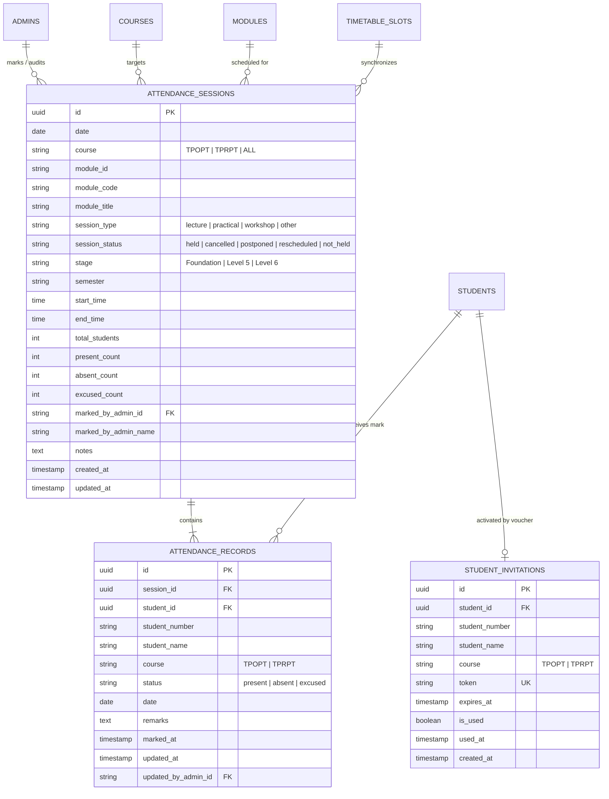

# University College of Rathmalana — Division of Television Studies
## Attendance Database Design & Relational Architecture Specification

**Project:** UCR Academic Portal — Batch 11 (2026 Intake)  
**Document:** `ATTENDANCE_DATABASE_DESIGN.md`  
**Authoritative Timezone:** `Asia/Colombo`  
**Official Tracking Start Date:** `2026-11-16`

---

## 1. Overview & Data Philosophy

The UCR Attendance System enforces authoritative timetable synchronization, module separation, role-based security, and non-destructive historical tracking. The schema guarantees:

1. **Session Atomicity:** Multiple lecture modules conducted on the same calendar day are stored as independent, distinct sessions (`attendance_sessions`).
2. **Timetable Linkage:** Sessions inherit module codes, titles, and scheduled slots directly from the authoritative timetable schedule.
3. **Tracking Date Boundary:** Tracking officially commences on **16 November 2026**. Foundation orientation dates prior to 16 Nov 2026 are never calculated as absences or assumed records.
4. **Clean Session Status Model:** Supports `held`, `cancelled`, `postponed`, `rescheduled`, and `not_held`. Non-conducted sessions are automatically excluded from the calculation denominator and absence metrics.
5. **Separation of Concerns:** Attendance marks for each student session row (`attendance_records`) reference the master session row via foreign keys with cascading protections and a composite unique constraint `(session_id, student_id)`.

---

## 2. Entity-Relationship Diagram (ERD)



---

## 3. Relational Schema & Table Definitions

### 3.1 `attendance_sessions` Table
Stores each official lecture, practical, or workshop session conducted or scheduled for Batch 11.

```sql
CREATE TABLE IF NOT EXISTS public.attendance_sessions (
    id UUID PRIMARY KEY DEFAULT gen_random_uuid(),
    date DATE NOT NULL,
    course VARCHAR(10) NOT NULL CHECK (course IN ('TPOPT', 'TPRPT', 'ALL')),
    module_id VARCHAR(64) NOT NULL,
    module_code VARCHAR(32),
    module_title VARCHAR(255) NOT NULL,
    session_type VARCHAR(20) NOT NULL DEFAULT 'lecture' 
        CHECK (session_type IN ('lecture', 'practical', 'workshop', 'other')),
    session_status VARCHAR(20) NOT NULL DEFAULT 'held' 
        CHECK (session_status IN ('held', 'cancelled', 'postponed', 'rescheduled', 'not_held')),
    stage VARCHAR(32) NOT NULL DEFAULT 'Foundation',
    semester VARCHAR(32) DEFAULT 'Semester 1',
    start_time TIME WITHOUT TIME ZONE,
    end_time TIME WITHOUT TIME ZONE,
    total_students INTEGER NOT NULL DEFAULT 0,
    present_count INTEGER NOT NULL DEFAULT 0,
    absent_count INTEGER NOT NULL DEFAULT 0,
    excused_count INTEGER NOT NULL DEFAULT 0,
    marked_by_admin_id VARCHAR(64) NOT NULL,
    marked_by_admin_name VARCHAR(128) NOT NULL,
    notes TEXT,
    created_at TIMESTAMP WITH TIME ZONE DEFAULT timezone('utc'::text, now()) NOT NULL,
    updated_at TIMESTAMP WITH TIME ZONE DEFAULT timezone('utc'::text, now()) NOT NULL
);

-- Performance Indexes
CREATE INDEX IF NOT EXISTS idx_attendance_sessions_date ON public.attendance_sessions (date);
CREATE INDEX IF NOT EXISTS idx_attendance_sessions_course ON public.attendance_sessions (course);
CREATE INDEX IF NOT EXISTS idx_attendance_sessions_module_code ON public.attendance_sessions (module_code);
CREATE INDEX IF NOT EXISTS idx_attendance_sessions_status ON public.attendance_sessions (session_status);
CREATE INDEX IF NOT EXISTS idx_attendance_sessions_stage ON public.attendance_sessions (stage);
```

### 3.2 `attendance_records` Table
Stores the roll-call mark for an individual student for a given session.

```sql
CREATE TABLE IF NOT EXISTS public.attendance_records (
    id UUID PRIMARY KEY DEFAULT gen_random_uuid(),
    session_id UUID NOT NULL REFERENCES public.attendance_sessions(id) ON DELETE CASCADE,
    student_id UUID NOT NULL,
    student_number VARCHAR(32) NOT NULL,
    student_name VARCHAR(128) NOT NULL,
    course VARCHAR(10) NOT NULL CHECK (course IN ('TPOPT', 'TPRPT')),
    status VARCHAR(20) NOT NULL CHECK (status IN ('present', 'absent', 'excused')),
    date DATE NOT NULL,
    remarks TEXT,
    marked_at TIMESTAMP WITH TIME ZONE DEFAULT timezone('utc'::text, now()) NOT NULL,
    updated_at TIMESTAMP WITH TIME ZONE DEFAULT timezone('utc'::text, now()) NOT NULL,
    updated_by_admin_id VARCHAR(64),
    
    -- Composite Unique Constraint: Prevents duplicate marking of the same student per session
    CONSTRAINT uq_attendance_session_student UNIQUE (session_id, student_id)
);

-- Performance Indexes
CREATE INDEX IF NOT EXISTS idx_attendance_records_session_id ON public.attendance_records (session_id);
CREATE INDEX IF NOT EXISTS idx_attendance_records_student_id ON public.attendance_records (student_id);
CREATE INDEX IF NOT EXISTS idx_attendance_records_student_number ON public.attendance_records (student_number);
CREATE INDEX IF NOT EXISTS idx_attendance_records_date ON public.attendance_records (date);
CREATE INDEX IF NOT EXISTS idx_attendance_records_status ON public.attendance_records (status);
```

### 3.3 `student_invitations` Table
Manages secure 7-day single-use access vouchers for student onboarding.

```sql
CREATE TABLE IF NOT EXISTS public.student_invitations (
    id UUID PRIMARY KEY DEFAULT gen_random_uuid(),
    student_id UUID,
    student_number VARCHAR(32),
    student_name VARCHAR(128),
    course VARCHAR(10) CHECK (course IN ('TPOPT', 'TPRPT')),
    token VARCHAR(64) NOT NULL UNIQUE,
    expires_at TIMESTAMP WITH TIME ZONE NOT NULL,
    is_used BOOLEAN NOT NULL DEFAULT FALSE,
    used_at TIMESTAMP WITH TIME ZONE,
    created_at TIMESTAMP WITH TIME ZONE DEFAULT timezone('utc'::text, now()) NOT NULL
);

CREATE INDEX IF NOT EXISTS idx_student_invitations_token ON public.student_invitations (token);
CREATE INDEX IF NOT EXISTS idx_student_invitations_student_number ON public.student_invitations (student_number);
CREATE INDEX IF NOT EXISTS idx_student_invitations_is_used ON public.student_invitations (is_used);
```

---

## 4. Row Level Security (RLS) & Role Privileges

Supabase Row Level Security is strictly applied:

| Role | `attendance_sessions` | `attendance_records` | `student_invitations` |
| :--- | :--- | :--- | :--- |
| **SuperAdmin** | Full Access (`SELECT`, `INSERT`, `UPDATE`, `DELETE`) | Full Access (`SELECT`, `INSERT`, `UPDATE`, `DELETE`) | Full Access (Generate, Revoke, Expire) |
| **Representative** | `SELECT`, `INSERT`, `UPDATE` within assigned course (`TPOPT` or `TPRPT`) | `SELECT`, `INSERT`, `UPDATE` within assigned course | Read-only / Filter Unused codes |
| **Student** | Read-only matching own enrolled course (`TPOPT` or `TPRPT` or `ALL`) | **Read-only restricted strictly to `auth.uid() = student_id`** | No access |

### Server-Side RLS Enforcement Example:
```sql
ALTER TABLE public.attendance_records ENABLE ROW LEVEL SECURITY;

-- Students can ONLY view their own records
CREATE POLICY "Students can view only own attendance records"
ON public.attendance_records
FOR SELECT
USING (
  auth.role() = 'authenticated' AND (
    student_id = auth.uid() OR 
    EXISTS (
      SELECT 1 FROM public.admins 
      WHERE admins.id = auth.uid() 
      AND admins.role IN ('superadmin', 'representative')
    )
  )
);

-- Representatives can insert/update only within their assigned course
CREATE POLICY "Representatives can manage cohort attendance"
ON public.attendance_records
FOR ALL
USING (
  EXISTS (
    SELECT 1 FROM public.admins
    WHERE admins.id = auth.uid()
    AND (
      admins.role = 'superadmin' OR
      (admins.role = 'representative' AND admins.course = attendance_records.course)
    )
  )
);
```

---

## 5. Audit Logging Architecture

All attendance mutations (creation, modification, cancellation, student profile update) trigger non-destructive structured audit log records in `audit_logs`:
- **Actor:** `actor_id`, `actor_name`, `actor_role`.
- **Target:** `entity_type` (`attendance_session`, `attendance_record`, `student_profile`), `entity_id`.
- **Delta:** `action` (`CREATE`, `UPDATE`, `CANCEL`, `DELETE`), `metadata` (JSON snapshot of changes).
- **Timestamp:** Stored in UTC, localized to `Asia/Colombo` on administrative dashboard review.

